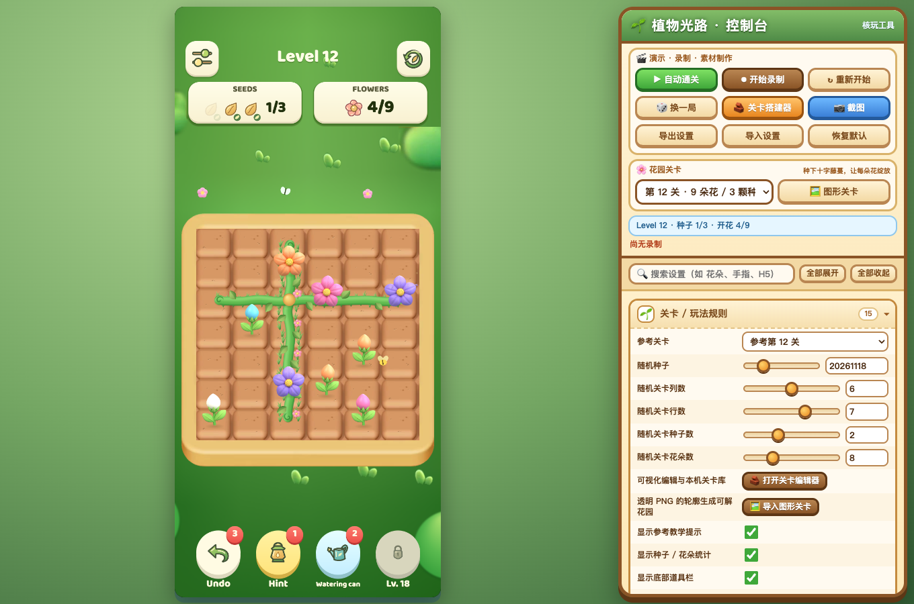

# 植物光路 · 核玩工具

在花园里，用有限的种子让所有花苞开放。每粒种子向四方长藤，先长出的藤会挡住后来的藤。你可以自己解谜、编关、录制解法，也可以把当前关卡导出成可玩的广告。

**离线打开：** 从仓库选择 **Code → Download ZIP**，解压后用 Chrome 或 Edge 打开根目录的 `index.html`。不需要服务器、账号或网络。



[手机试玩画面](screenshots/garden-controls-playable.png) · [关卡编辑器](screenshots/garden-controls-editor.png)

## 玩法和编辑

- 按住空格预览藤蔓的方向，拖动可以调整位置，松手播种。移出棋盘再松手即可取消。藤蔓经过的花苞会开放；已有的藤路和形状缺口会挡住后续生长。
- 土格和花苞依次入场。花朵会轻摆，手指划过花或藤叶时，碰到的那株会弯下后回弹。「花园 / 美术」可调整草地配色、藤宽、粒子强度和交互动效。
- 内置第 2–12 关；第 4、7、12 关分别解锁撤销、提示和浇水。提灯指出下一步，浇水壶能单独催开一朵花。自动通关使用实际求解器，默认不开始录像。
- 打开「关卡搭建器」可调整行列、种子数、花苞位置和缺口。编辑器支持撤销、重做、解法检查、本机关卡库和 JSON 导入导出。也可以导入透明 PNG，从轮廓生成有解关卡。
- 设置保存在当前浏览器。v2.1 沿用旧存储位置，v2.0 的默认外观会恢复到花园版；自订设置及本机关卡可继续使用。跨电脑请分别导出设置和关卡。

## 录制与导出

| 输出 | 内容 |
| --- | --- |
| PNG、视频 | 当前画布的截图，或含音轨的 MP4 / WebM。支持设置分辨率、帧率和码率。 |
| After Effects | 先启动时间轴记录，再手动游玩或演示，导出独立 PNG 图层、关键帧、音效和 `build_ae_project.jsx`。在 AE 中运行脚本建工程。 |
| 3D 工程 | 同一段记录可导出 GLB、FBX 和 Blender 导入脚本。植物、图版、指针和 HUD 是可编辑的 **2.5D 贴图平面**。 |
| H5 试玩 | 把当前实际关卡打入单文件。保留手机操作和安装按钮，不含制作控制台或演示指针。支持 AppLovin、Meta、Google、Mintegral、Moloco、TikTok、Unity 和 Generic。投放前在面板填写落地页 URL 并用相应平台预览。 |

## 图像来源与版本范围

v2.1 在原版花园中重绘了玩家可见的功能图标。控制台、关卡搭建器和工具按钮沿用 v1.4.1 的外观。新图标的绘制源在 [src/garden-hud-icons.js](src/garden-hud-icons.js)；花苞、花头和叶片来自本项目的 [Blender 生成脚本](scripts/render_botanicals.py)，声音为 WebAudio 合成。

原花园的部分背景、棋盘与装饰来自参考视频的清理图，11 个内置关卡沿用了参考布局。更新功能图标没有改变其来源或授权状态。来源及依赖许可见 [THIRD_PARTY_LICENSES.txt](THIRD_PARTY_LICENSES.txt)。

## 本地开发

```sh
npm ci
npm run build
npm run dev
npm run test:all
```

建议 Node.js 22 或更新版本。开发预览默认监听 `127.0.0.1:4173`。浏览器验证使用本地 Chrome，3D 验证使用 Blender，录屏文件使用 ffprobe 检查。AE 验证使用脚本对象模型模拟与图层合成比对，未在 After Effects 本体内执行。

游戏规则见 [src/core.js](src/core.js)，工作台入口见 [src/main.js](src/main.js)，场景和按钮绘制见 [src/render.js](src/render.js)。`npm run build` 同时生成离线工作台和可导出的精简试玩。
