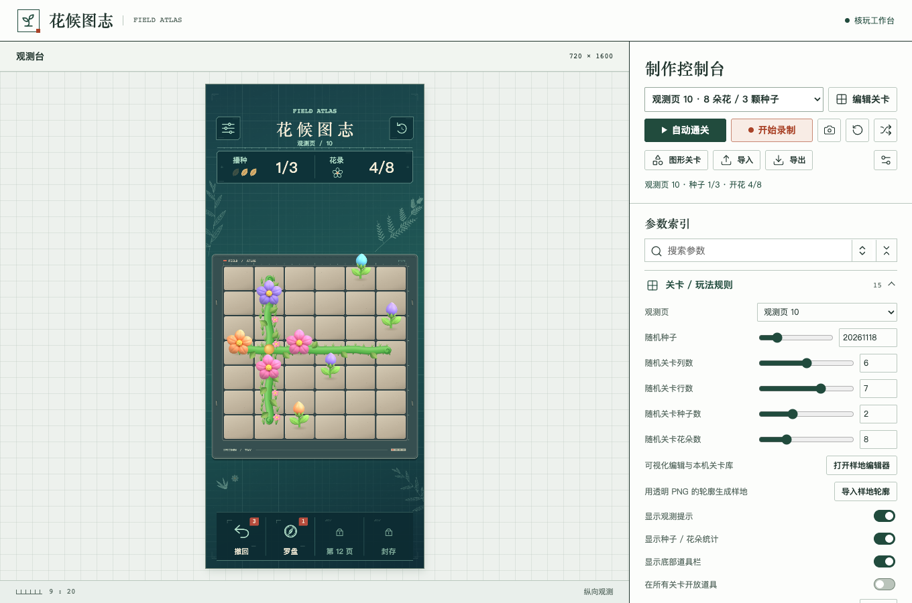

# 花候图志 · 核玩工具

在一张植物观测图版上，用有限的种子让所有花苞开放。每粒种子向四方长藤，先长出的藤会挡住后来的藤。你可以自己解谜、编关、录制解法，也可以把当前关卡导出成可玩的广告。

**离线打开：** 从仓库选择 **Code → Download ZIP**，解压后用 Chrome 或 Edge 打开根目录的 `index.html`。不需要服务器、账号或网络。



[手机试玩画面](screenshots/atlas-playable.png) · [样地编辑器](screenshots/atlas-editor.png)

## 玩法和编辑

- 按住空格预览藤蔓的方向，拖动可以调整位置，松手播种。移出棋盘再松手即可取消。藤蔓经过的花苞会开放；已有的藤路和形状缺口会挡住后续生长。
- 每关以样方和花苞依次入场。静止的花朵会轻摆；手指划过花或叶片时，只有碰到的那株会偏转并回弹。「图版 / 配色」可以调整图版颜色、藤宽和粒子密度，或关闭交互动效。
- 内置观测页 02–12；第 4、7、12 页开放撤回、罗盘和补水。罗盘指出下一步，补水能单独催开一朵花。自动通关使用实际求解器，默认不开始录像。
- 在制作控制台选择「编辑关卡」可调整行列、种子数、花苞位置和缺口。编辑器支持撤销、重做、解法检查、本机关卡库和 JSON 导入导出。也可以导入透明 PNG，从轮廓生成有解样地。
- 设置保存在当前浏览器。v2 沿用旧存储位置，并识别 v1 默认配色、指针和公开文案；自订设置及本机关卡可继续使用。跨电脑请分别导出设置和关卡。

## 录制与导出

| 输出 | 内容 |
| --- | --- |
| PNG、视频 | 当前画布的截图，或含音轨的 MP4 / WebM。支持设置分辨率、帧率和码率。 |
| After Effects | 先启动时间轴记录，再手动游玩或演示，导出独立 PNG 图层、关键帧、音效和 `build_ae_project.jsx`。在 AE 中运行脚本建工程。 |
| 3D 工程 | 同一段记录可导出 GLB、FBX 和 Blender 导入脚本。植物、图版、指针和 HUD 是可编辑的 **2.5D 贴图平面**。 |
| H5 试玩 | 把当前实际关卡打入单文件。保留手机操作和安装按钮，不含制作控制台或演示指针。支持 AppLovin、Meta、Google、Mintegral、Moloco、TikTok、Unity 和 Generic。投放前在面板填写落地页 URL 并用相应平台预览。 |

## 图像来源与版本范围

v2 将工作台、编辑器、场景、计数栏、道具、教学、通关卡、结束页及 H5 操作栏改为统一的植物图志视觉。图版、陶格、装订托盘、线描植物、花束和水具由本项目的 Canvas 路径绘制；默认记录笔由矢量路径绘制。花苞、花头和叶片继续使用本项目的 [Blender 生成脚本](scripts/render_botanicals.py) 与 [渲染记录](src/art-assets/polished/README.md)。声音为 WebAudio 合成。部分工作台图标来自 Lucide，完整署名及依赖许可见 [THIRD_PARTY_LICENSES.txt](THIRD_PARTY_LICENSES.txt)。

v2 当前文件和导出物不再分发 v1 的参考场景贴图或默认手势位图。旧提交仍在公开 Git 历史中。**内置 11 关沿用对参考视频整理的布局**，没有随 UI 改版替换。要制作独立关卡包，可直接编辑新样地或导出随机生成的关卡。

## 本地开发

```sh
npm ci
npm run build
npm run dev
npm run test:all
```

建议 Node.js 22 或更新版本。开发预览默认监听 `127.0.0.1:4173`。浏览器验证使用本地 Chrome，3D 验证使用 Blender，录屏文件使用 ffprobe 检查。AE 验证使用脚本对象模型模拟与图层合成比对，未在 After Effects 本体内执行。

游戏规则见 [src/core.js](src/core.js)，工作台入口见 [src/main.js](src/main.js)，游戏图版和 HUD 分别见 [src/atlas-scene.js](src/atlas-scene.js) 与 [src/atlas-hud.js](src/atlas-hud.js)。`npm run build` 同时生成离线工作台和可导出的精简试玩。
